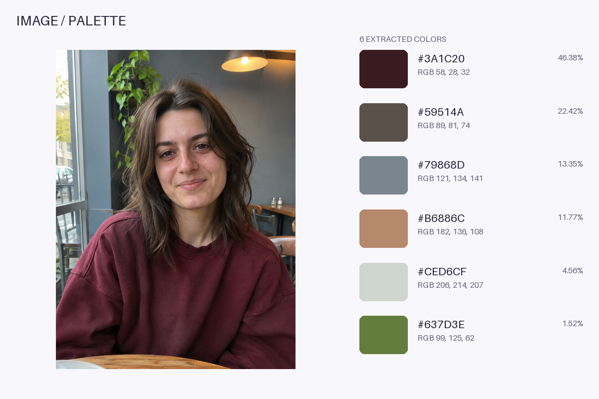
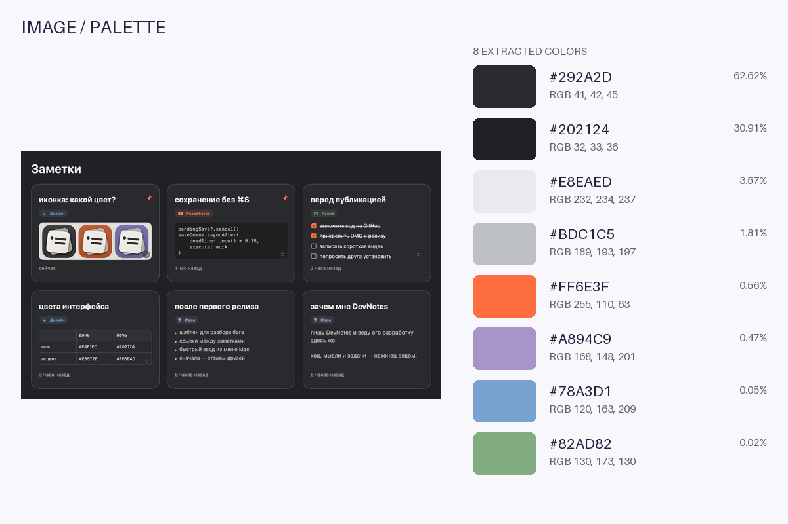

# Local Image Palette

Extract a color palette from an image, entirely on your computer. Compare the source and swatches side by side, copy HEX/RGB values, and export CSS variables or JSON.

Python + Pillow. No API keys, network calls, browser, or MCP server at runtime.

## Examples

### Landscape · general mode


| HEX | RGB | Approx. share |
| --- | --- | --- |
| `#859733` | 133, 151, 51 | 29.48% |
| `#799CB2` | 121, 156, 178 | 18.73% |
| `#77ACF2` | 119, 172, 242 | 17.44% |
| `#2E423A` | 46, 66, 58 | 15.74% |
| `#526323` | 82, 99, 35 | 12.23% |
| `#939B60` | 147, 155, 96 | 6.37% |

### Portrait · general mode



| HEX | RGB | Approx. share |
| --- | --- | --- |
| `#3A1C20` | 58, 28, 32 | 46.38% |
| `#59514A` | 89, 81, 74 | 22.42% |
| `#79868D` | 121, 134, 141 | 13.35% |
| `#B6886C` | 182, 136, 108 | 11.77% |
| `#CED6CF` | 206, 214, 207 | 4.56% |
| `#637D3E` | 99, 125, 62 | 1.52% |

### Interface · UI mode



| HEX | RGB | Approx. share |
| --- | --- | --- |
| `#292A2D` | 41, 42, 45 | 62.62% |
| `#202124` | 32, 33, 36 | 30.91% |
| `#E8EAED` | 232, 234, 237 | 3.57% |
| `#BDC1C5` | 189, 193, 197 | 1.81% |
| `#FF6E3F` | 255, 110, 63 | 0.56% |
| `#A894C9` | 168, 148, 201 | 0.47% |
| `#78A3D1` | 120, 163, 209 | 0.05% |
| `#82AD82` | 130, 173, 130 | 0.02% |

### Illustration · general mode


| HEX | RGB | Approx. share |
| --- | --- | --- |
| `#0A0E33` | 10, 14, 51 | 71.11% |
| `#FAD3A9` | 250, 211, 169 | 18.14% |
| `#816599` | 129, 101, 153 | 6.42% |
| `#34346B` | 52, 52, 107 | 3.57% |
| `#48DEEF` | 72, 222, 239 | 0.45% |
| `#3792B0` | 55, 146, 176 | 0.30% |

The landscape and portrait are **AI-generated demo images**, not camera photographs. See [image provenance and prompts](examples/PROVENANCE.md). Each output folder contains copyable `palette.json` and `palette.css` files.

## Quick start

Requires Python 3.11+ on macOS or Linux. Windows is not currently supported (the input-file safeguards use POSIX flags).

From the repository directory:

```sh
python3 -m venv .venv
.venv/bin/python -m pip install -r requirements.txt
mkdir -p output
.venv/bin/python scripts/extract.py examples/inputs/landscape.png --output-root output
```

For screenshots:

```sh
.venv/bin/python scripts/extract.py examples/inputs/interface.png --mode ui --colors 8 --output-root output
```

The output root must already exist. Every run creates a fresh `palette-*` folder containing:

| File | Content |
| --- | --- |
| `palette.png` | Source image and palette, vertically centered |
| `palette.json` | HEX, RGB, approximate percentages and method |
| `palette.css` | `--palette-1`, `--palette-2`, … variables |

The command prints JSON with the new folder path. Colors are sorted by estimated share.

## Use as a Codex skill

The repository is a self-contained skill: `SKILL.md` and `scripts/extract.py` live together. Copy this directory to `~/.codex/skills/local-image-palette` (do not overwrite an existing installation), then create its `.venv` and install `requirements.txt` as above. The skill becomes available on the next turn.

Attach an image and ask:

> $local-image-palette Extract six colors, show the image next to the palette, and list copyable HEX codes.

## Extraction intent

Intent and image type are independent. The default is `--intent design`.

| Intent | Use for | Color values |
| --- | --- | --- |
| `design` | A diverse palette for design; current heuristic, not guaranteed accent retention | Group averages for photos/art; samples for UI |
| `dominant` | Main colors by image area | Quantized representative averages |
| `exact` | Representative colors actually present | Sampled sRGB values, no final HEX averaging |

```sh
.venv/bin/python scripts/extract.py examples/inputs/portrait.png --intent exact --output-root output
.venv/bin/python scripts/extract.py examples/inputs/interface.png --mode ui --intent dominant --output-root output
```

Exact does not mean every pixel color or original CSS tokens. Percentages always describe approximate groups. Codex infers intent from ordinary wording and does not require a mode selection. Existing checked-in examples predate this option and illustrate the default design behavior. Experimental selection remains separate.

## How extraction works

- **General** (default, six colors): downsample to 256 × 256, median-cut quantization, then weighted clustering in Lab with diverse initial centers. HEX values represent group averages.
- **UI** (default, eight colors): sample up to 768 × 768 without blending pixels; retain common neutral surfaces and distinct hue accents. HEX values are sampled colors, not inferred design tokens.
- `--colors` accepts 2–8. Images with fewer distinct colors can return fewer swatches.
- EXIF orientation is respected; embedded ICC profiles are converted to sRGB. Images without a profile are assumed sRGB.
- Pixels with alpha below 128 are ignored. Percentages describe groups of nearby sampled colors, not exact original-pixel coverage; rounding may prevent a total of exactly 100%.

Small details can still be missed. UI mode is heuristic: it does not identify components or recover a design system. A color present in a screenshot can differ from its CSS token due to compositing or color management.

## Safety boundaries

Only local, single-frame JPEG, PNG and WebP files are accepted: at most 25 MiB and 20 million pixels. Final-component symlinks and nonregular inputs are rejected. No subprocesses or image-content execution. Exports go to a fresh private folder; originals are not modified. The comparison PNG embeds only a resized preview, without source metadata.

This is **not an OS sandbox**. Choose trusted input/output locations and keep Pillow maintained. Image decoders are dependencies, not a guarantee that arbitrary files are harmless. Installation requires package downloads; extraction itself is offline.

## Development

```sh
.venv/bin/python -m unittest discover -s tests
```

## License

Source code: [MIT](LICENSE). Example images are excluded from the code license; see [provenance](examples/PROVENANCE.md).
