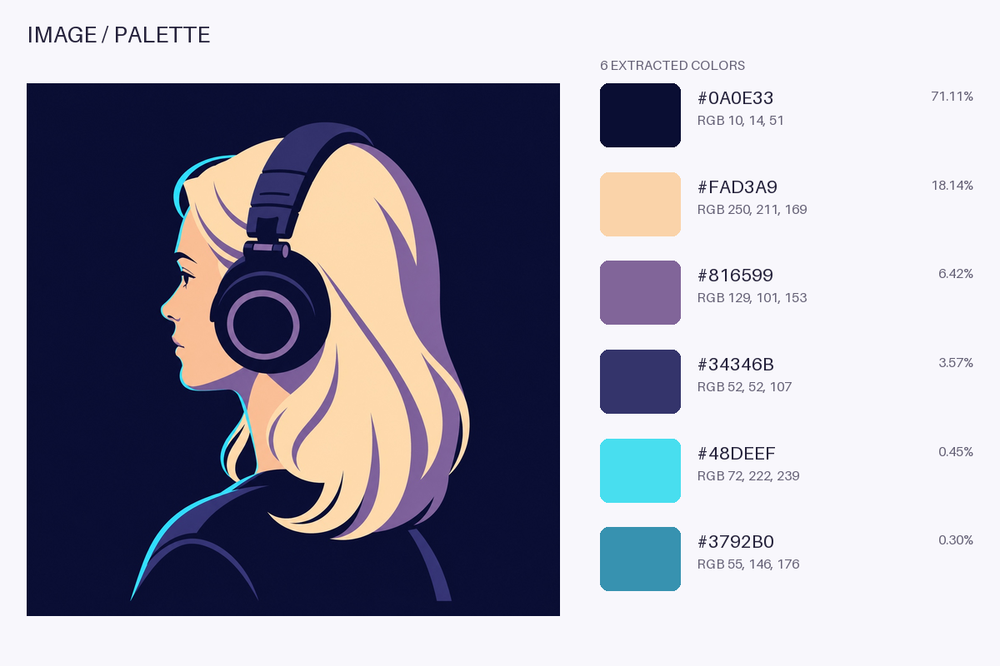
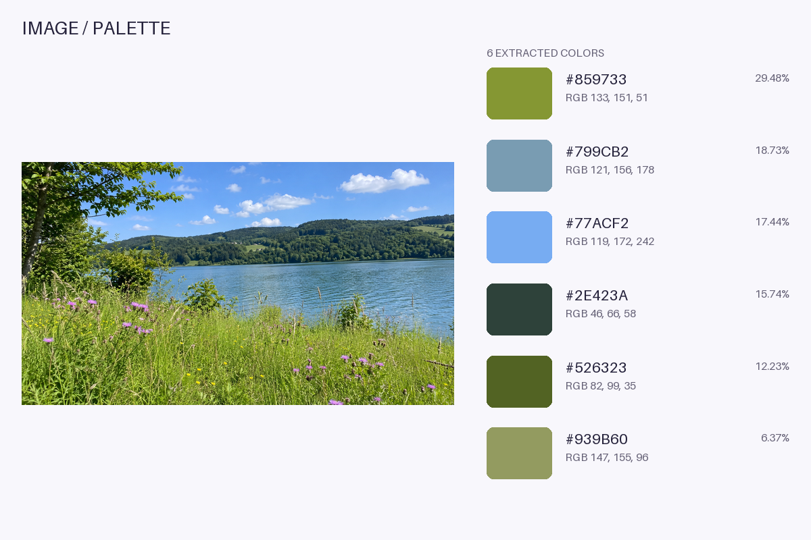

# Huecue 🎨

Huecue extracts color palettes from photos, illustrations, and UI screenshots. Use the colors in interfaces, presentations, or brand moodboards.

It works as a Codex skill or a Python command-line tool. Images are processed on your computer with Pillow; extraction needs no network connection or API key.

- 🖼️ Compare the image and palette side by side.
- 📋 Copy HEX/RGB values or export CSS variables and JSON.
- 🎯 Choose a palette for design, dominant colors, or sampled colors.

## Examples 🖼️

### Illustration · general mode



- Midnight blue — `#0A0E33` · ≈71.11%
- Peach cream — `#FAD3A9` · ≈18.14%
- Muted violet — `#816599` · ≈6.42%
- Deep indigo — `#34346B` · ≈3.57%
- Bright cyan — `#48DEEF` · ≈0.45%
- Ocean blue — `#3792B0` · ≈0.30%

### Landscape · general mode



- Olive green — `#859733` · ≈29.48%
- Blue gray — `#799CB2` · ≈18.73%
- Sky blue — `#77ACF2` · ≈17.44%
- Deep forest — `#2E423A` · ≈15.74%
- Moss green — `#526323` · ≈12.23%
- Sage green — `#939B60` · ≈6.37%

### Portrait · general mode


- Deep burgundy — `#3A1C20` · ≈46.38%
- Warm gray — `#59514A` · ≈22.42%
- Slate gray — `#79868D` · ≈13.35%
- Warm tan — `#B6886C` · ≈11.77%
- Pale sage — `#CED6CF` · ≈4.56%
- Leaf green — `#637D3E` · ≈1.52%

### Interface · UI mode


- Charcoal — `#292A2D` · ≈62.62%
- Near black — `#202124` · ≈30.91%
- Soft white — `#E8EAED` · ≈3.57%
- Silver gray — `#BDC1C5` · ≈1.81%
- Coral orange — `#FF6E3F` · ≈0.56%
- Lavender — `#A894C9` · ≈0.47%
- Dusty blue — `#78A3D1` · ≈0.05%
- Sage green — `#82AD82` · ≈0.02%

The landscape and portrait are **AI-generated demo images**, not camera photographs. See [image provenance and prompts](examples/PROVENANCE.md). Each output folder contains copyable `palette.json` and `palette.css` files.

## Quick start ✨

Requires Python 3.11+ on macOS or Linux. Windows is not currently supported (the input-file safeguards use POSIX flags).

From the repository directory:

```sh
python3 -m venv .venv
.venv/bin/python -m pip install -r requirements.txt
mkdir -p output
.venv/bin/python scripts/extract.py examples/inputs/landscape.png --output-root output
```

For screenshots:

```sh
.venv/bin/python scripts/extract.py examples/inputs/interface.png --mode ui --colors 8 --output-root output
```

The output root must already exist. Every run creates a fresh `palette-*` folder containing:

| File | Content |
| --- | --- |
| `palette.png` | Source image and palette, vertically centered |
| `palette.json` | HEX, RGB, approximate percentages and method |
| `palette.css` | `--palette-1`, `--palette-2`, … variables |

The command prints JSON with the new folder path. Colors are sorted by estimated share.

## Use with Codex 🤖

The repository is a self-contained skill: `SKILL.md` and `scripts/extract.py` live together. Copy this directory to `~/.codex/skills/huecue` (do not overwrite an existing installation), then create its `.venv` and install `requirements.txt` as above. The skill becomes available on the next turn.

Attach an image and ask:

> $huecue Extract six colors, show the image next to the palette, and list copyable HEX codes.

## Palette options 🎯

Intent and image type are independent. The default is `--intent design`.

| Intent | Use for | Color values |
| --- | --- | --- |
| `design` | A diverse palette for design; current heuristic, not guaranteed accent retention | Group averages for photos/art; samples for UI |
| `dominant` | Main colors by image area | Quantized representative averages |
| `exact` | Representative colors actually present | Sampled sRGB values, no final HEX averaging |

```sh
.venv/bin/python scripts/extract.py examples/inputs/portrait.png --intent exact --output-root output
.venv/bin/python scripts/extract.py examples/inputs/interface.png --mode ui --intent dominant --output-root output
```

Exact does not mean every pixel color or original CSS tokens. Percentages always describe approximate groups. Codex infers intent from ordinary wording and does not require a mode selection. Existing checked-in examples predate this option and illustrate the default design behavior. Experimental selection remains separate.

## How it works 🔎

- **General** (default, six colors): downsample to 256 × 256, median-cut quantization, then weighted clustering in Lab with diverse initial centers. HEX values represent group averages.
- **UI** (default, eight colors): sample up to 768 × 768 without blending pixels; retain common neutral surfaces and distinct hue accents. HEX values are sampled colors, not inferred design tokens.
- `--colors` accepts 2–8. Images with fewer distinct colors can return fewer swatches.
- EXIF orientation is respected; embedded ICC profiles are converted to sRGB. Images without a profile are assumed sRGB.
- Pixels with alpha below 128 are ignored. Percentages describe groups of nearby sampled colors, not exact original-pixel coverage; rounding may prevent a total of exactly 100%.

Small details can still be missed. UI mode is heuristic: it does not identify components or recover a design system. A color present in a screenshot can differ from its CSS token due to compositing or color management.

## File handling and safety 🔒

Only local, single-frame JPEG, PNG and WebP files are accepted: at most 25 MiB and 20 million pixels. Final-component symlinks and nonregular inputs are rejected. No subprocesses or image-content execution. Exports go to a fresh private folder; originals are not modified. The comparison PNG embeds only a resized preview, without source metadata.

This is **not an OS sandbox**. Choose trusted input/output locations and keep Pillow maintained. Image decoders are dependencies, not a guarantee that arbitrary files are harmless. Installation requires package downloads; extraction itself is offline.

## Development 🛠️

```sh
.venv/bin/python -m unittest discover -s tests
```

## License 📄

Source code: [MIT](LICENSE). Example images are excluded from the code license; see [provenance](examples/PROVENANCE.md).
